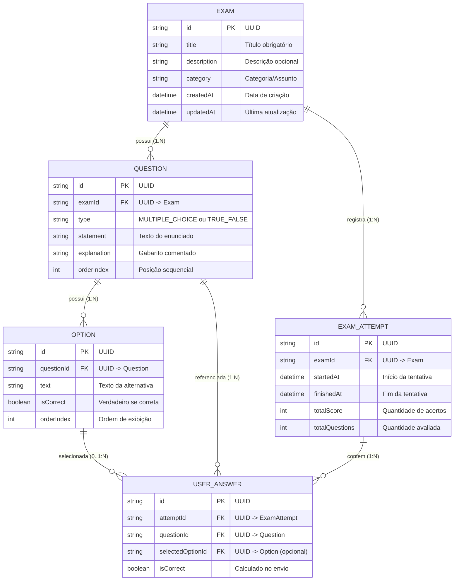

# Documentação Técnica e Arquitetural do Sistema de Simulados

**Data de Elaboração:** 21 de Outubro de 2026  
**Versão do Sistema:** 1.2.0  
**Status do Projeto:** Estável / Produção Local  
**Objetivo do Documento:** Fornecer um panorama completo e detalhado da arquitetura, modelo de dados, regras de negócio, fluxos de tela e parâmetros operacionais do sistema atual de simulados, servindo como especificação canônica para reprodução em outras plataformas (como Flutter com SQLite).

---

## 1. Visão Geral e Propósito

O **Sistema Pessoal de Simulados** é uma plataforma focada no estudo intensivo, autoavaliação e preparação técnica para exames e certificações (como OutSystems Associate Reactive Developer O11). 

O sistema foi desenhado para ser ágil, moderno, sem fricção de login (sem autenticação obrigatória para ambiente de estudos pessoais) e com alto poder pedagógico:
- **Banco de Questões Flexível:** O simulado pode ter centenas de questões cadastradas, permitindo que o estudante configure a realização de sessões menores (ex: responder 10, 20 ou 50 questões sorteadas e embaralhadas aleatoriamente a cada sessão).
- **Cronômetro de Prova em Tempo Real:** Medição precisa do tempo de resolução, com recurso de pausa/retomada e registro da duração total de cada tentativa.
- **Gabarito Comentado e Revisão Detalhada:** Não apenas informa a pontuação, mas exibe questão a questão a alternativa marcada pelo aluno, a alternativa correta e a justificativa técnica detalhada elaborada por especialistas.
- **Painel de Desempenho e Estatísticas Históricas:** Rastreamento do número de tentativas por simulado, média geral de aproveitamento e taxa de acerto da última realização.
- **Modos Duplos de Inserção de Conteúdo:** Cadastro manual interativo ou importação em lote via JSON compatível com prompts para IA (ChatGPT, Gemini, Claude).

---

## 2. Arquitetura Atual do Sistema

O sistema foi construído como um monolito moderno em **Next.js**:

```text
┌─────────────────────────────────────────────────────────────────────────────┐
│                            FRONTEND (Next.js 16)                            │
│  - React 19 (Server & Client Components)                                    │
│  - Tailwind CSS + Lucide Icons                                              │
│  - Lucide React (Ícones Vetoriais)                                          │
└──────────────────────────────────────┬──────────────────────────────────────┘
                                       │ Server Actions (Chamadas RPC tipadas)
┌──────────────────────────────────────▼──────────────────────────────────────┐
│                             BACKEND / NEGÓCIO                               │
│  - Next.js Server Actions ('use server')                                    │
│  - Validações Zod (examSchema, questionSchema, optionSchema)                │
│  - Motor de pontuação e amostragem (calculateScore, sampleQuestions)         │
│  - Prisma ORM 5.x / 6.x (Client fortemente tipado)                          │
└──────────────────────────────────────┬──────────────────────────────────────┘
                                       │ Conexão TCP / Driver PostgreSQL
┌──────────────────────────────────────▼──────────────────────────────────────┐
│                        BANCO DE DADOS (PostgreSQL 17)                       │
│  - Container Docker: simulados_postgres (porta host: 5433)                  │
│  - Transações Atômicas ACID (prisma.$transaction)                           │
│  - Cascata de Exclusão (onDelete: Cascade)                                  │
└─────────────────────────────────────────────────────────────────────────────┘
```

---

## 3. Modelo de Dados (Entidades e Relacionamentos)

O banco de dados relacional é composto por 5 tabelas interligadas:



### Especificação dos Campos

| Tabela | Coluna | Tipo | Regras / Comportamento |
| :--- | :--- | :--- | :--- |
| **exams** | `id` | UUID | Chave primária automática |
| | `title` | Text | Título do simulado (1 a 200 caracteres) |
| | `description` | Text (nullable) | Contextualização do exame |
| | `category` | Text (nullable) | Tag de agrupamento (ex: "OutSystems O11", "Geral") |
| | `createdAt` / `updatedAt` | Timestamp | Registro temporal automático |
| **questions** | `id` | UUID | Chave primária automática |
| | `examId` | UUID FK | Chave estrangeira de `exams.id` (`onDelete: Cascade`) |
| | `type` | Enum / Text | `MULTIPLE_CHOICE` ou `TRUE_FALSE` |
| | `statement` | Text | Enunciado completo da questão |
| | `explanation` | Text (nullable) | Justificativa didática do gabarito |
| | `orderIndex` | Integer | Ordenação natural no questionário (iniciando em 0) |
| **options** | `id` | UUID | Chave primária automática |
| | `questionId` | UUID FK | Chave estrangeira de `questions.id` (`onDelete: Cascade`) |
| | `text` | Text | Texto da alternativa (ex: "Certo", "A", etc.) |
| | `isCorrect` | Boolean | Exatamente uma opção por questão deve ser `true` |
| | `orderIndex` | Integer | Ordenação natural das alternativas |
| **exam_attempts** | `id` | UUID | Chave primária da tentativa de prova |
| | `examId` | UUID FK | Chave estrangeira de `exams.id` (`onDelete: Cascade`) |
| | `startedAt` | Timestamp | Data e hora em que a prova começou |
| | `finishedAt` | Timestamp (nullable) | Data e hora em que a prova foi enviada |
| | `totalScore` | Integer | Número total de questões acertadas |
| | `totalQuestions` | Integer | Número de questões avaliadas na sessão |
| **user_answers** | `id` | UUID | Chave primária do registro da resposta |
| | `attemptId` | UUID FK | Chave estrangeira de `exam_attempts.id` (`onDelete: Cascade`) |
| | `questionId` | UUID FK | Chave estrangeira de `questions.id` (`onDelete: Cascade`) |
| | `selectedOptionId`| UUID FK (nullable)| Alternativa marcada pelo aluno (`onDelete: SetNull`) |
| | `isCorrect` | Boolean | `true` se `selectedOption.isCorrect == true` |

---

## 4. Funcionalidades e Telas do Sistema

### 4.1. Dashboard Principal (`/`)
- **Cards de Métricas Globais:**
  1. *Total de Simulados:* Contagem de provas cadastradas.
  2. *Banco de Questões:* Soma de todas as questões do sistema.
  3. *Tentativas Realizadas:* Total acumulado de provas feitas.
  4. *Aproveitamento Geral:* Média percentual ponderada de todas as tentativas.
  5. *Último Desempenho:* Porcentagem de acerto da última prova finalizada.
- **Listagem de Simulados:**
  - Card de cada simulado contendo:
    - Categoria e Título em destaque.
    - Contagem de questões cadastradas no banco.
    - Histórico resumido: número de tentativas, média de acerto (%) e última nota com badge colorido.
    - Botão **"Iniciar Simulado"**: abre o diálogo de configuração da sessão.
    - Botão **"Editar"**: gerenciar questões e detalhes.
    - Botão **"Excluir"**: modal com confirmação.
- **Botão Novo Simulado:** Acesso rápido ao criador.

### 4.2. Diálogo de Configuração de Sessão (Question Bank / Amostragem)
- Permite ao estudante selecionar quantas questões quer responder na sessão atual:
  - Opção *"Todas as questões"* (ex: 150 de 150).
  - Opções de amostra (ex: 10, 20, 30, 50 questões).
- Toggle de **Embaralhamento Aleatório (Shuffle)**:
  - Quando ativado, seleciona uma amostra aleatória e reordena as questões a cada início de prova.
- O resultado da prova avalia única e exclusivamente as questões sorteadas na sessão.

### 4.3. Player de Simulado (`/exams/[id]/play`)
- **Barra Superior Fixa:**
  - Botão de voltar ao início.
  - Categoria, título e indicador de amostragem (ex: "20 de 150 do banco").
  - **Cronômetro em Tempo Real:** Formato `MM:SS` ou `HH:MM:SS`, ponto pulsante verde/âmbar, botão de Pausar e Retomar.
  - Botão de **Grade de Questões**: abre gaveta/drawer com todos os números das questões, indicando com cor diferenciada quais já foram respondidas e permitindo salto direto.
  - Botão **Finalizar**: aciona o modal de confirmação.
- **Banner de Pausa:** Quando o cronômetro é pausado, uma faixa visual avisa que o tempo está congelado e oferece o botão para retomar.
- **Barra de Progresso Visual:** Indicador contínuo em gradiente com percentual de conclusão.
- **Card da Questão:**
  - Tag da questão (ex: `Questão #3`) e tipo (`Múltipla Escolha` ou `Certo / Errado`).
  - Botão *"Limpar resposta"* quando há opção marcada.
  - Enunciado da questão em tipografia de alto contraste e legibilidade.
  - Lista de alternativas:
    - Badges `A`, `B`, `C`, `D` ou `C` / `E`.
    - Seleção com destaque em borda, fundo suave e anel de foco.
- **Navegação:** Botões *"Anterior"* e *"Próxima"* / *"Revisar e Finalizar"*.
- **Modal de Confirmação:**
  - Mostra total respondido vs total de questões.
  - Informa o **Tempo Total Decorrido** (ex: `14 min 32 s`).
  - Alerta caso existam questões sem resposta.

### 4.4. Tela de Resultados e Gabarito Comentado (`/exams/[id]/results/[attemptId]`)
- **Banner de Aproveitamento:**
  - Porcentagem de acerto em destaque (ex: `85%`).
  - Feedback visual automático:
    - $\ge 80\%$: *Excelente Aproveitamento!* (Verde).
    - $60\% - 79\%$: *Bom Desempenho!* (Âmbar).
    - $< 60\%$: *Continue Praticando!* (Vermelho).
- **Métricas Quantitativas:**
  - Questões Corretas, Questões Incorretas/Em Branco, Total da Prova e **Tempo de Prova**.
- **Revisão Detalhada Questão a Questão:**
  - Card de cada questão da tentativa com:
    - Status: Ícone verde de acerto ou ícone vermelho de erro.
    - Enunciado completo.
    - Lista de alternativas com marcação visual explícita:
      - Alternativa selecionada pelo usuário (destacada).
      - Alternativa correta da prova (destacada em verde).
      - Se o usuário errou, a opção dele fica em vermelho e a correta em verde.
    - Caixa pedagógica destacada de **Justificativa / Comentário da Resposta**.
- **Ações Finais:** Botão *"Refazer Simulado"* (inicia nova sessão limpa) e *"Início"*.

### 4.5. Criação e Edição de Simulados (`/exams/new` e `/exams/[id]/edit`)
- **Dados Gerais:** Título, Categoria e Descrição.
- **Dois Modos de Adição:**
  1. *Modo Visual:* Formulário reativo para adicionar/remover questões, alternar entre Múltipla Escolha e Certo/Errado, preencher alternativas e marcar o gabarito.
  2. *Modo Importação em Lote (JSON):* Permite colar JSON estruturado de dezenas de questões geradas por prompts de IA com botão de exemplo e validação sintática.
- **Exclusão Segura:** Ação de exclusão em cascata.

---

## 5. Conteúdo Pré-instalado: Simulado OutSystems O11 (150 Questões)

O sistema possui cadastrado um banco completo de **150 questões avançadas** sobre a certificação **OutSystems Associate Reactive Developer O11**, englobando:
- Aggregates (Joins, Aggregations, Group By, Count vs Length, Índices e Otimizações).
- Bootstrap do Excel e Timers de carga massiva com commit periódico.
- Ciclo de Vida de Telas e Blocos (`On Initialize`, `On Ready`, `On Render`, `On Destroy`, `On Parameters Changed`).
- Client vs Server Actions (Serialização JSON, latência de rede, controle transacional).
- Client Variables e Segurança (Local Storage, manipulação e restrições).
- Dependências Modulares e Architecture Canvas (4-Layer Framework, Upward References, Side References, Breaking Changes).
- Entidades e Static Entities (Identificadores constantes, Delete Rules `Protect`/`Delete`/`Ignore`, Integridade referencial 1:1 e 1:N).
- Eventos de Blocos e Handlers de Telas.
- Obtenção de dados (`Fetch = At start` vs `Only on demand`, Data Actions).
- Paginação, Ordenação dinâmica e Infinite Scroll.
- Segurança e Roles (`Registered`, Anônimo, `CheckRole` no cliente vs servidor).
- Tratamento de Exceções e Transações (`Abort Transaction = Yes/No`, rollback de loops).
- Validações de Formulários (`Built-in Validations`, recálculo automático de `Form.Valid`).

---

## 6. Implementação Flutter Mobile com SQLite (Totalmente Concluída)

O ecossistema mobile foi integralmente construído em **Flutter** dentro da pasta `simulados_app/`, espelhando 100% das regras e adicionando recursos exclusivos para dispositivos móveis:

| Recurso Web (Next.js) | Implementação Flutter Mobile (`simulados_app`) |
| :--- | :--- |
| **Banco de Dados:** PostgreSQL via Prisma | **SQLite** nativo via `sqflite` com inicialização e migrações atômicas |
| **Modelos de Dados:** Prisma Models | Classes Dart com tipagem estrita e serialização `toMap()` e `fromMap()` |
| **Gerenciamento de Estado:** React Server Actions / Hooks | **MVVM com Provider e ChangeNotifier** |
| **Cronômetro:** `useEffect` + `setInterval` | `dart:async` `Timer.periodic` com formatação digital e verbose |
| **Estilização:** Tailwind CSS v4 | **Material 3** com `ThemeData` responsivo para smartphones e tablets |
| **Seed Inicial:** `prisma/seed-outsystems.ts` | Carregamento automático via asset JSON `outsystems_seed.json` |
| **Pastas & Pinning:** Agrupamento e fixação no topo | Suporte a pastas, filtro horizontal e fixação de simulados prioritários |
| **Importador / Gerador com IA:** Prompt modal e parser | **IA integrada**, sanitização de barras do Gemini e colchetes do ChatGPT (`\[` e `\]`), fechamento do modal após validação estrita e **processamento em segundo plano com indicador visual na AppBar** |

---

## 7. Créditos de Desenvolvimento com Agente de IA

Tanto a aplicação Web quanto o aplicativo Mobile Flutter foram desenvolvidos com assistência de um **Agente Autônomo de Inteligência Artificial** ([Antigravity](https://deepmind.google/)), garantindo código limpo, cobertura de testes automatizados, tratamento de layout responsivo (sem erros de overflow) e sanitização rigorosa de dados.

